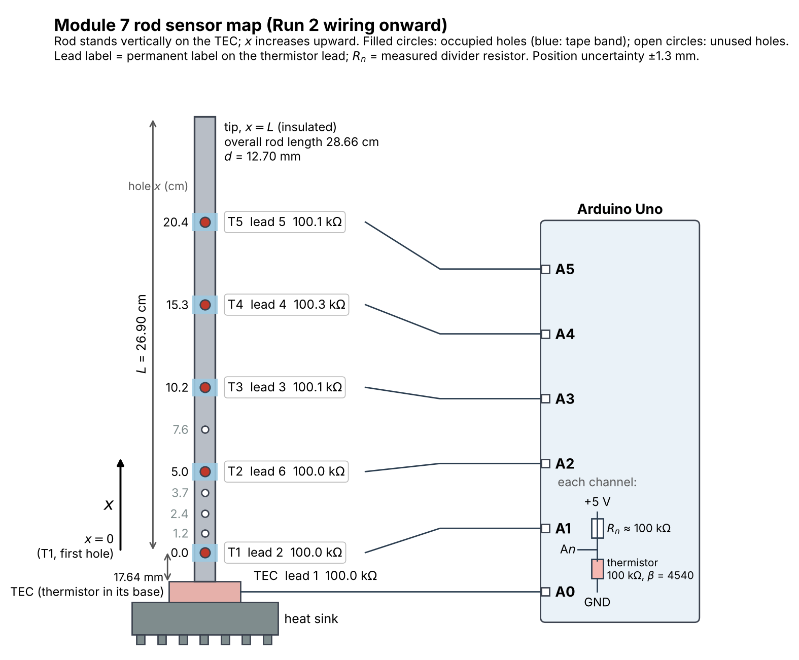
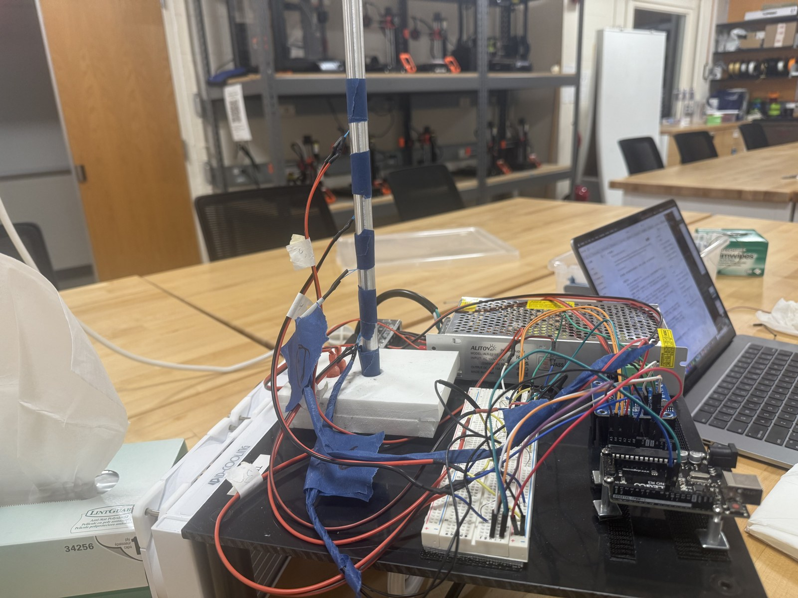
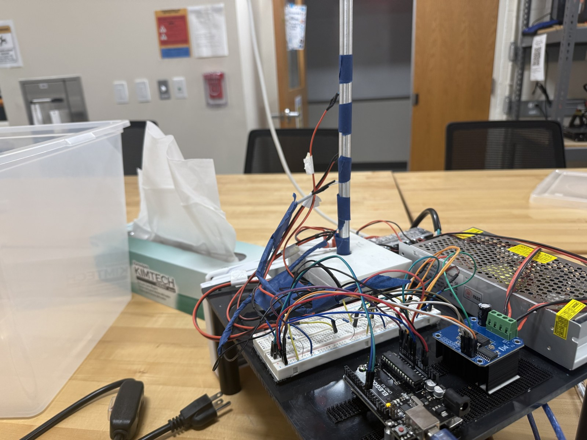
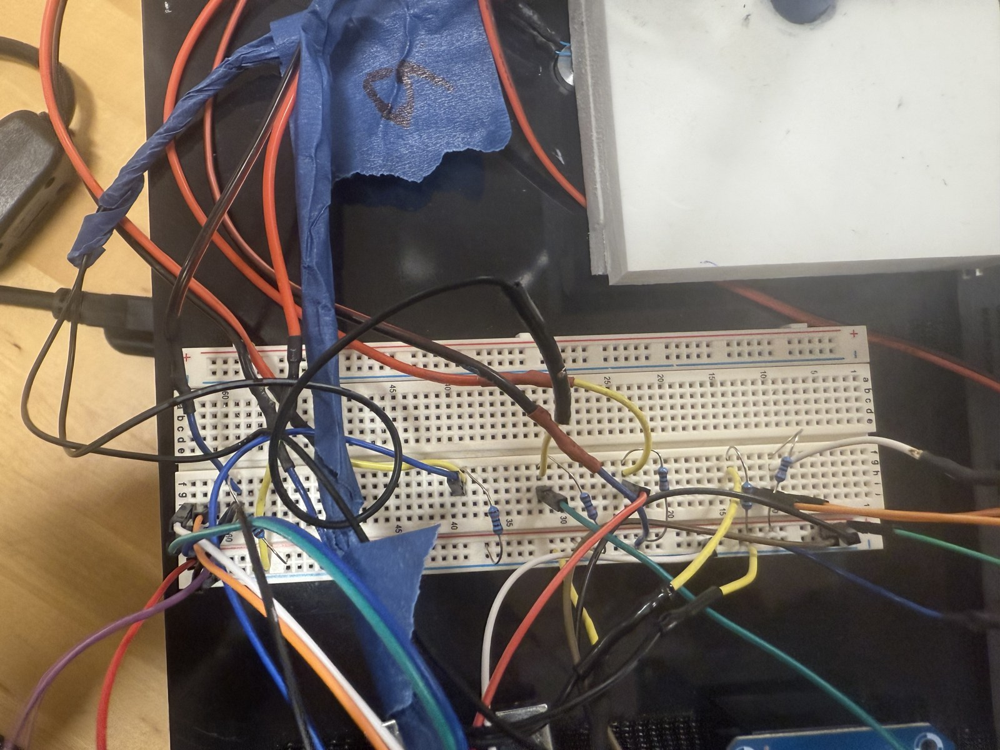
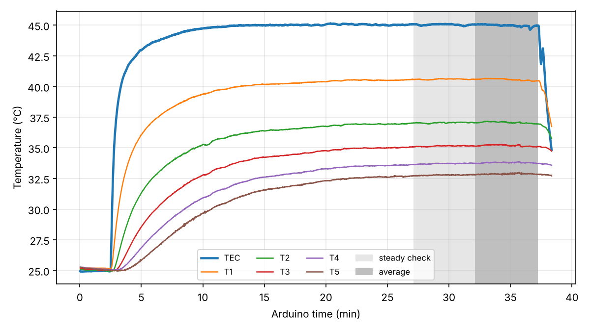

# Module 7, Part III: Rod Instrument — Sensor Map, Checks, and Run Log

Team record for the six-thermistor rod instrument (Phases 1–4 and the C5 checkoff).

## 1. Rod geometry

| Quantity | Value | How measured |
| --- | --- | --- |
| Material | 6061-T6 aluminum | handout |
| Diameter $d$ | 12.70 ± 0.02 mm | digital calipers (0.01 mm resolution) |
| Overall physical length | 28.66 ± 0.05 cm | ruler (1 mm divisions) |
| Thermistor-hole diameter | 2.50–2.55 mm | calipers |
| TEC end to near edge of the first hole | 16.38 mm | calipers |
| First-hole offset $s$ (to its center) | 17.64 mm | 16.38 mm + half the hole diameter |
| Analyzed length $L$ (first hole to tip) | 26.90 ± 0.05 cm | overall length − $s$ |
| $A=\pi d^2/4$, $P=\pi d$ | $1.267\times10^{-4}\ \mathrm{m^2}$, $3.990\times10^{-2}$ m | from $d$ |
| Hole positions $x$ from the first hole | 0, 1.2, 2.4, 3.7, 5.0, 7.6, 10.2, 15.3, 20.4 cm | ruler |
| Position uncertainty | ±1.3 mm | half the hole diameter |

Coordinate: $x=0$ at the center of the first thermistor hole (rod thermistor T1),
increasing toward the free tip at $x=L$. The rod stands vertically on the TEC, so $x$
increases upward.

Each rod thermistor is held in its hole by a band of blue painter's tape. The tape
surface radiates far more than bare aluminum (emissivity roughly 0.9 against roughly
0.05–0.1), so the side heat loss is somewhat larger at the taped bands than between
them. The model assumes one uniform $h$; this is a systematic effect to discuss in the
Phase 5 analysis.

## 2. Sensor map

Wiring and positions as used in Run 1 (`rod_20261111-084156`):

| Lead label | Arduino input | CSV column | GUI label | Hole $x$ (cm) | Run 1 |
| :---: | --- | --- | --- | ---: | --- |
| 1 | A0 | `tec_C` | TEC | TEC base | good |
| 2 | A2 | `rod2_C` | T2 | 0.0 | good |
| 6 | A1 | `rod1_C` | T1 | 5.0 | good |
| 3 | A4 | `rod4_C` | T4 | 10.2 | **faulty**: reads the same point as A2 |
| 4 | A5 | `rod5_C` | T5 | 15.3 | good |
| 5 | A3 | `rod3_C` | T3 | 20.4 | **faulty**: reads the same point as A2 |

From Run 2 (`rod_20261111-101158`) on, the inputs follow the holes in physical order,
each with its own divider and breadboard row, so the GUI labels match the positions in
`SENSOR_POSITIONS_CM`:

| Lead label | Arduino input | CSV column | GUI label | Hole $x$ (cm) | Divider resistor (measured) |
| :---: | --- | --- | --- | ---: | ---: |
| 1 | A0 | `tec_C` | TEC | TEC base | 100.0 kΩ |
| 2 | A1 | `rod1_C` | T1 | 0.0 | 100.0 kΩ |
| 6 | A2 | `rod2_C` | T2 | 5.0 | 100.0 kΩ |
| 3 | A3 | `rod3_C` | T3 | 10.2 | 100.1 kΩ |
| 4 | A4 | `rod4_C` | T4 | 15.3 | 100.3 kΩ |
| 5 | A5 | `rod5_C` | T5 | 20.4 | 100.1 kΩ |



*Diagram drawn from this table by `python/analysis/module_07_sensor_map_diagram.py`; the
breadboard itself is too crowded to photograph legibly.*

The Run 2 stationary profile decreases monotonically from T1 to T5 (40.5, 37.0, 35.1, 33.8,
32.9 °C), as it must if each input reads its own hole.

The leads carry permanent labels numbered 1–6; the labels identify the leads, and wire
colors are not recorded. Each divider is wired +5 V → resistor → analog input →
thermistor → GND and stays with its lead; the resistors carry the same numbers 1–6. Their
values, measured with a multimeter, are 100.0, 100.0, 100.1, 100.3, 100.1, and 100.0 kΩ
for dividers 1–6. The largest deviation from nominal, 0.3 %, shifts a reading by about
$(T^2/\beta)(0.003)\approx0.06$ °C at room temperature, and the per-channel baseline
removes such constant offsets, so the sketch keeps the nominal 100 000 Ω for every
channel in `SERIES_RESISTOR_OHM`. Final hole positions go in
`SENSOR_POSITIONS_CM` in the GUI, which writes them to every run's metadata file.

Photos (in `docs/figures/module_07/`; the lead labels are not legible at this size):

- `rod_apparatus_overview.jpg`: the instrument, with the rod on the TEC, the H-bridge,
  the Arduino, and the power supply.
- `rod_apparatus_wiring.jpg`: the thermistor leads taped to the rod.
- `breadboard_dividers.jpg`: the six 100 kΩ divider resistors on the breadboard.







## 3. Software

| Part | File | Git commit |
| --- | --- | --- |
| Arduino acquisition and TEC output | `arduino/module_07_rod_controller/module_07_rod_controller.ino` | `1c05d7c` (unchanged since `db47ad3`) |
| Python display, P/PI control, raw CSV | `python/module_07_rod_acquisition_gui.py` | `1c05d7c` (last change `03be0ac`: `SERIAL_PORT` for the Mac) |
| Offline self-test of the GUI | `python/module_07_gui_selftest.py` | |
| Stationary-fin fits (Phase 5) | `python/analysis/module_07_stationary_fit.py` | |

The code files are identical in `a5d6a6f` (recorded in the Run 1 metadata), `1c05d7c`
(Run 2), `5cbaf4d` (room baseline), and the final commit. The "+uncommitted changes" flag
in the metadata files refers to other files in the working copy, such as new data files.

Serial record (one per ~1 s average, header printed once at start-up):

```text
DATA,time_s,tec_C,rod1_C,rod2_C,rod3_C,rod4_C,rod5_C,pwm,heat_cool,setpoint_C,safety
```

Only the TEC thermistor (A0) enters the P/PI law and the 60 °C software limit; the rod
thermistors are measurement channels. A missing rod thermistor reads `nan` without stopping
the TEC.

## 4. Integration checks (Step 2C)

Done with the Module 7 sketch and Serial Monitor (9600 baud), TEC power off.

- [x] Warming each thermistor by hand, one at a time, raised only its own column:
  A0 → `tec_C`, A1 → `rod1_C`, A2 → `rod2_C`, A3 → `rod3_C`, A4 → `rod4_C`,
  A5 → `rod5_C`. No other column changed.
- [x] The Arduino starts with PWM 0: every record after reset reads `pwm` 0,
  `heat_cool` 1, `setpoint_C` nan, `safety` OK (log in section 5). The zero-power command
  `SET PWM 0 DIR HEAT`, which the GUI sends at start-up and after every record in manual
  mode, is accepted with no error message (GUI console, run `rod_20261110-182219`).
- [x] The GUI's numbers and the CSV rows agree: the screenshots at $t$ = 2458.65, 3333.37,
  and 3862.25 s (run `rod_20261111-084156`) and at 57.79 s (run `rod_20261110-182219`)
  show exactly the values in the matching CSV rows.
- [x] Unplugging a thermistor turns its column into `nan`. With A0 (TEC) unplugged, the
  Arduino prints `SAFETY SHUTDOWN ACTIVE` and the TEC-base safety shutdown works.
- [x] Restarting both programs gives PWM 0 and a new data file: each GUI start wrote its
  own file (`rod_20261110-175653.csv`, `rod_20261110-175839.csv`) with `pwm` 0 and
  `safety` OK throughout, and the metadata recorded the port, code files, and commit.

## 5. Channel-agreement check (Phase 3)

Criterion: full spread $T_{\max}-T_{\min}$ of the six readings below 1 °C; if so, no
calibration corrections are applied.

The six thermistors were read together in still room air at the bench, TEC power off,
with the Module 7 sketch and every divider resistance still at its default 100 000 Ω.
Because the spread was below 1 °C, the instructor said the hot-water common bath was not
needed.

Mean of the 12 records from $t=2.28$ to 13.38 s (Serial Monitor):

| | TEC | T1 | T2 | T3 | T4 | T5 |
| --- | ---: | ---: | ---: | ---: | ---: | ---: |
| Reading (°C) | 22.91 | 23.06 | 23.15 | 23.50 | 23.84 | 23.06 |
| Difference from TEC (°C) | 0 | +0.15 | +0.24 | +0.59 | +0.93 | +0.15 |

Spread: 0.94 °C in the largest single record (0.93 °C for the means), below 1 °C.
Record-to-record noise: about ±0.01–0.02 °C on every channel.

**Result:** passed; the raw readings are used with no calibration corrections.

Notes:

- T4 and T3 read highest (+0.9 and +0.6 °C relative to TEC). With every divider within
  ±1 % (at most about 0.2 °C), most of this offset comes from the thermistors themselves
  or from their positions in the air, not from the resistors.
- Phase 4 repeats the agreement check with the rod at 20 °C before heating.

Serial Monitor log:

```text
DATA,time_s,tec_C,rod1_C,rod2_C,rod3_C,rod4_C,rod5_C,pwm,heat_cool,setpoint_C,safety
DATA,2.28,22.91,23.06,23.15,23.51,23.85,23.06,0,1,nan,OK
DATA,3.29,22.91,23.06,23.15,23.49,23.84,23.06,0,1,nan,OK
DATA,4.30,22.91,23.06,23.15,23.49,23.84,23.06,0,1,nan,OK
DATA,5.30,22.91,23.06,23.15,23.50,23.83,23.06,0,1,nan,OK
DATA,6.31,22.91,23.06,23.15,23.50,23.83,23.06,0,1,nan,OK
DATA,7.32,22.91,23.06,23.15,23.50,23.83,23.06,0,1,nan,OK
DATA,8.33,22.91,23.06,23.15,23.50,23.82,23.06,0,1,nan,OK
DATA,9.34,22.91,23.06,23.15,23.49,23.83,23.06,0,1,nan,OK
DATA,10.35,22.91,23.06,23.14,23.51,23.85,23.06,0,1,nan,OK
DATA,11.36,22.91,23.06,23.14,23.51,23.85,23.06,0,1,nan,OK
DATA,12.37,22.91,23.06,23.14,23.51,23.84,23.06,0,1,nan,OK
DATA,13.38,22.91,23.06,23.14,23.51,23.84,23.06,0,1,nan,OK
```

### Baseline with the thermistors installed (TEC off)

GUI files `data/module_07/rod_20261110-175653.csv` (70 s) and
`rod_20261110-175839.csv` (455 s), PWM 0 throughout:

| | TEC | T1 | T2 | T3 | T4 | T5 |
| --- | ---: | ---: | ---: | ---: | ---: | ---: |
| Median (°C), 70 s file | 22.76 | 22.83 | 23.16 | 23.50 | 23.83 | 22.91 |
| Difference from T1 (°C) | −0.07 | 0 | +0.33 | +0.67 | +1.00 | +0.08 |

- Spread 1.07 °C (rod channels alone 1.00 °C): at or above the 1 °C criterion. Without
  heating, an aluminum rod cannot hold a 1 °C difference over 15 cm, so these are channel
  offsets, not temperature differences.
- The offsets climb by almost exactly 0.33 °C per channel from T1 to T4 and drop back at T5.
  Random thermistor tolerances would not line up like this, and resistor tolerance (±1 %)
  allows at most about 0.2 °C, so a wiring or grounding difference between breadboard
  positions is suspected. 0.33 °C is about 4 ADC counts, or about 20 mV at the input.
- In the 455 s file, T2, T3, and T4 jump together (by up to 0.3 °C, largest on T4) at
  $t\approx87$, 242, 291, 360, and 395 s, while TEC, T1, and T5 stay flat: a disturbance
  shared by those three channels.
- From $t=433$ s, T5 read erratic values between −17 and +22 °C (a disturbed or loose
  connection rather than a clean `nan`), and the USB link dropped at 466.6 s
  (`Device not configured`). Two 4 s gaps in the records (at 270 and 284 s).

To do before the step run: swap two thermistors between channels to see whether the offset
stays with the channel (wiring) or moves with the sensor; check the A2–A4 dividers' 5 V and
GND connections on the breadboard (split power rails, loose jumpers, a ground shared with
the cooler or H-bridge); then repeat this baseline. Ask the instructor whether the
remaining offsets may be removed with an isothermal-baseline offset correction or need
the common-bath calibration.

## 6. Prediction record before heating

Provisional values from A4 (`python/analysis/a4_part3_finite_length.py`), with
$h=10\ \mathrm{W/(m^2\ K)}$, $k=167$ W/(m K), $d=12.70$ mm, and $L=26.90$ cm:

| Quantity | Value |
| --- | --- |
| $m$, $1/m$ | 4.34 $\mathrm{m^{-1}}$, 23.0 cm |
| $mL$ | 1.17 |
| $\mathrm{Bi_\perp}=hd/(4k)$ | $1.9\times10^{-4}$ |

| Sensor | $x$ (cm) | Predicted $\Theta_{\mathrm{finite}}$ | Predicted $\theta$ for $\theta_0=25$ K | $\epsilon_T$ |
| --- | ---: | ---: | ---: | ---: |
| T1 | 0.0 | 1.000 | 25.0 K | 0 % |
| T2 | 5.0 | 0.843 | 21.1 K | 4.6 % |
| T3 | 10.2 | 0.723 | 18.1 K | 11.2 % |
| T4 | 15.3 | 0.641 | 16.0 K | 19.7 % |
| T5 | 20.4 | 0.590 | 14.7 K | 30.1 % |

Phase 4 asks for a pilot placement in which the excess temperature drops by at least a
factor $e$ from T1 to the farthest sensor. The prediction is that this rod cannot meet
that: the farthest hole (20.4 cm) is predicted at $\Theta=0.59$ for $h=10$ and still
0.40 for $h=20\ \mathrm{W/(m^2\ K)}$, above $1/e=0.368$.

Predictions:

1. **Order of response to the 20 → 45 °C step.** The TEC thermistor responds first, then
   T1 (x = 0), T2, T3, T4, and T5 in order of distance. Heat spreads by diffusion, so the
   delay grows roughly as x²/α (α ≈ 6.9×10⁻⁵ m²/s for 6061-T6): about 0.5 min at 5 cm,
   2.5 min at 10 cm, 6 min at 15 cm, and 10 min at 20 cm. Farther sensors start later and
   rise more slowly, with an S-shaped start instead of an immediate rise.

2. **Response amplitude vs distance.** The steady temperature rise falls monotonically with
   distance. The predicted fractions Θ = θ/θ₀ are 1.00, 0.84, 0.72, 0.64, and 0.59 for
   T1–T5, i.e. about 25, 21, 18, 16, and 15 K if T1 ends 25 K above room temperature
   (θ₀ at T1 will probably be somewhat less than the TEC's rise). The drop between
   neighbouring sensors gets smaller toward the tip.

3. **Shape of the stationary profile.** θ(x) decreases monotonically and is concave up,
   following cosh[m(L − x)]/cosh(mL), with zero slope at the insulated tip. On a plot of
   ln θ against x it is not a straight line: its slope, −m tanh[m(L − x)], is steepest at
   the base (−m tanh(mL) ≈ −3.6 m⁻¹) and flattens to zero at the tip. The farthest sensor
   stays above θ₀/e (Θ ≈ 0.59 for h = 10, still 0.40 for h = 20 W/(m² K)), so the
   factor-e drop asked for in Phase 4 should not be reachable on this rod.

4. **Does the measured region reveal the finite tip?** Yes. With mL ≈ 1.2 the
   semi-infinite model differs from the finite one by ε_T ≈ 11 %, 20 %, and 30 % at T3, T4,
   and T5. The semi-infinite fit should leave a systematic residual pattern and give a
   smaller m than the finite fit, while the finite insulated-tip model should fit within
   the uncertainties. Whether the tip is insulated or convecting changes the prediction
   by only about 1 %.

If the placement pilot moves a sensor, keep this record and repeat the calculation with
the final measured position below.

## 7. Run log (Phase 4)

### Run 1: `data/module_07/rod_20261111-084156.csv`

| Item | Value |
| --- | --- |
| Baseline | TEC off, $t$ = 0–1102 s (about 18 min) |
| Step | P/PI control started at $t$ = 1102.6 s: $T_{\mathrm{set}}$ = 45 °C directly from the TEC-off baseline, $K_p$ = 6 PWM/°C, $K_i$ = 0.04 PWM/(°C s), $u_{\max}$ = 255, anti-windup on |
| Control | no overshoot; TEC within 0.1 °C of 45 °C after about 15 min; PWM settled near 49 |
| Steady state | over the last 10 min before control stopped, every channel had $\lvert dT/dt\rvert\le0.010$ °C/min (all drifting slowly down together, likely room temperature); criterion met |
| Control stopped | $t$ = 3908.8 s; records continue to 3942 s |
| Room temperature $T_\infty$ | no separate thermometer reading; each channel's own TEC-off baseline ($t$ = 60–1095 s) is its reference |

Excess temperature from each channel's own baseline (mean of the final 5 min minus mean of
$t$ = 60–1095 s):

| Channel | TEC | A1 | A2 | A3 | A4 | A5 |
| --- | ---: | ---: | ---: | ---: | ---: | ---: |
| $\theta$ (K) | 21.61 | 13.25 | 16.46 | 16.46 | 16.48 | 9.60 |
| Time to +0.2 K after the step | 1 s | 15 s | 6 s | 6 s | 6 s | 44 s |
| Time to 63 % of the rise | 30 s | 217 s | 120 s | 120 s | 120 s | 433 s |

**Problem: A2, A3, and A4 measure the same point.** Their rises agree to 0.03 K and their
timing is identical, which sensors in different holes cannot do. According to the team's
record, the leads are wired label 6 → A1, 2 → A2, 5 → A3, 3 → A4, 4 → A5, and sit along the
rod in the order 2, 6, 3, 4, 5 from the TEC. Then A4 (label 3) and A3 (label 5, farthest)
should read far below A2. They do not, so A3 and A4 are most likely connected to the same
divider node as A2 (a breadboard wiring error), not to their own thermistors. The
equal 0.33 °C steps between A2, A3, and A4 at room temperature fit the same explanation.

The three independent channels do decrease along the rod: A2 (label 2, $x$ = 0)
16.46 K, A1 (label 6, $x$ = 5.0 cm) 13.25 K, A5 (label 4, $x$ = 15.3 cm) 9.60 K. The
preliminary Phase 5 analysis of these three is in `module_07_stationary_fin.md`
(finite-fin $m$ = 4.87 ± 0.05 $\mathrm{m^{-1}}$).

### Run 2 (after fixing the wiring)

| Item | Value |
| --- | --- |
| Final positions of A1–A5 | 0, 5.0, 10.2, 15.3, 20.4 cm (section 2) |
| Room temperature $T_\infty$ | TEC-off baseline after the run: `rod_20261111-111314.csv`, $t$ = 534–834 s (11:22–11:27), every channel within 0.008 °C/min; T1 25.23 °C |
| Controller | PI on the TEC thermistor, $T_\mathrm{set}$ = 45 °C, $K_p$ = 6 PWM/°C, $K_i$ = 0.04 PWM/(°C s), anti-windup on |
| Data file | `data/module_07/rod_20261111-101158.csv` |
| TEC off (baseline) | $t$ = 2–138 s |
| Control start / stop | 138.6 s (10:14:18) / 2268.1 s (10:49:48) |
| Time at which the criterion was met | $t$ = 2200 s (10 min window 1600–2200 s), 34 min after the step; T5 still rose at 0.017 °C/min |
| Analysis interval | steady check 1630–2230 s, average 1930–2230 s |

At about 2235 s the setup lost power: the TEC reading dropped from 45 °C to 42 °C while
the controller raised the PWM, and control was stopped at 2268 s. The analysis ends at
2230 s, before this. A scan of the whole Run 2 file finds no record in which four or more
rod channels jump together by more than 0.08 °C, so no electrical glitch affects the
analyzed data.

**Reference temperature.** The baseline lasted only 2.3 min, and the rod had not finished
cooling from Run 1: during it T2–T5 still fell by 0.05–0.10 °C/min while the TEC reading
rose. The baseline means (about 25.1 °C) are therefore above the room temperature, by an
unknown amount. A common shift $\delta$ of the reference changes every $\theta_i$ by the
same amount and moves the fitted $m$:

| Reference below the baseline by | finite-fit $m$ ($\mathrm{m^{-1}}$) | $\chi^2$/dof |
| ---: | ---: | ---: |
| 0 K | 5.06 ± 0.04 | 4.0 |
| 0.5 K | 4.92 ± 0.04 | 4.2 |
| 1.0 K | 4.79 ± 0.04 | 4.5 |
| 1.6 K (Run 1 room, 08:42) | 4.64 ± 0.04 | 4.7 |

About 0.28 $\mathrm{m^{-1}}$ per kelvin, seven times the statistical uncertainty. The
profile cannot fix $\delta$ itself (a fit with $\delta$ free gives $-3.8 \pm 1.0$ K, not
physical). A TEC-off record taken after the rod has cooled back to room temperature, with
the same wiring, gives the reference (`--baseline-file`). The Run 1 baseline also drifted,
all channels together by +0.02 °C/min: the room was warming that morning.

With the 2.3-min baseline as the reference (superseded by the room
baseline below), the finite fit gives $m$ = 5.06 ± 0.04 $\mathrm{m^{-1}}$ with $\chi^2$/dof = 4.0 (3 dof), and the semi-infinite
fit $m$ = 3.35 ± 0.04 $\mathrm{m^{-1}}$ with $\chi^2$/dof = 45.9. The finite model is the
adequate one for any reasonable reference.

**Room baseline after Run 2.** With the same wiring and the TEC off, the rod was recorded
from 11:01 to 11:27 (`rod_20261111-110121` … `-111314`). The setup lost power again
during the first files: all six readings jumped together within single records, for
example by −2.3 °C at $t$ = 150 s in `-110121` and by −2.1 °C at $t$ = 58 s in `-110533`.
The rod cannot change temperature that fast, so these are changes in the measurement
chain, not in the rod. `rod_20261111-111314.csv` contains no such jumps, its last 5 min
are flat (every channel within 0.008 °C/min), and its per-channel values lie within
0.25 K of Run 2's own 2.3-min baseline, so the measurement chain is taken to be the same
as during Run 2. That interval is the reference for the final analysis:
$m$ = 4.90 ± 0.04 $\mathrm{m^{-1}}$ (`module_07_stationary_fin.md`). The cause of the
power dropouts should be found before the long Module 8 runs.



*Run 2 raw temperatures: 2.3-min baseline, step to 45 °C at 2.3 min, steady-state check
(light gray) and 5-min average (dark gray). Farther sensors respond later and rise less.*

## 8. C5 evidence checklist

- [x] Documented channel-agreement check: room air, spread 0.94 °C < 1 °C, no corrections (section 5)
- [x] Sensor coordinates and wiring (sections 1–2, photos; Run 2 wiring in section 2)
- [x] Synchronized six-channel logging: every DATA record carries all six channels with one
  Arduino `time_s` (raw CSVs in `data/module_07/`)
- [x] Live six-channel record approaching a stationary profile: Run 2,
  `rod_20261111-101158.csv`, time history in section 7
- [x] Files with timestamps, units, channel labels, and notes (raw CSV + `_meta.txt`)
- [ ] Pushed acquisition-code and evidence commit cited in the Moodle receipt
- [ ] Each member can trace one sensor from channel to CSV column and name the dominant
  uncertainty
