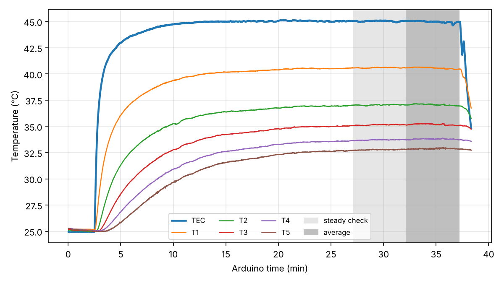
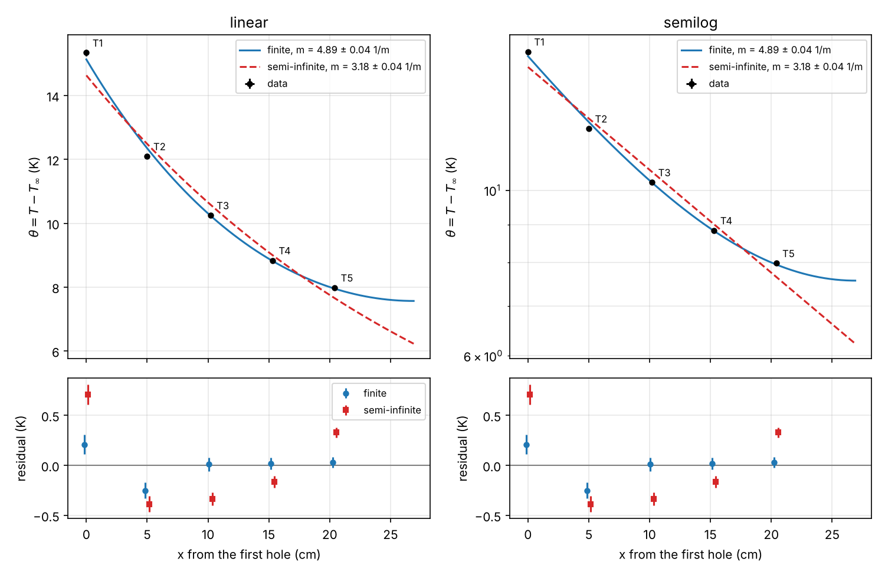

# Module 7, Part III: Stationary-Fin Analysis

Team record of the Phase 5 analysis (formative; reused for C6 and the final
presentation), from the stationary-profile run Run 2 (`rod_20261111-101158`).

Analysis command (from the repository root) for the final result, Run 2 with the
room-temperature baseline recorded after it:

```bash
python python/analysis/module_07_stationary_fit.py data/module_07/rod_20261111-101158.csv \
    --baseline 534,834 --baseline-file data/module_07/rod_20261111-111314.csv --t-end 2230
```

`--baseline` takes an Arduino-time interval during which the TEC was off and the rod sat
at room temperature; `--baseline-file` takes it from a separate file recorded with the same
wiring. Each channel's mean there serves as its own $T_\infty$, so
$\theta_i=T_i-T_{i,\mathrm{baseline}}$ and constant channel offsets cancel. The script
prints the tables below and saves `<run>_time_history.png` and `<run>_profile_fits.png`
to `docs/figures/module_07/`. Other options: `--positions-cm` (default 0, 5.0, 10.2,
15.3, 20.4), `--exclude` for faulty channels, `--t-inf` for one room temperature.

## Result

| Quantity | Value |
| --- | --- |
| Finite insulated-tip fit | $m$ = 4.90 ± 0.04 $\mathrm{m^{-1}}$, $1/m$ = 20.4 ± 0.2 cm, $\chi^2$/dof = 4.9 (3 dof) |
| Semi-infinite fit | $m$ = 3.18 ± 0.04 $\mathrm{m^{-1}}$, $1/m$ = 31.5 ± 0.4 cm, $\chi^2$/dof = 49.0 |
| Shift of $m$ when the finite end is ignored | −1.72 $\mathrm{m^{-1}}$, 45 times the fit uncertainty |
| $mL$ | 1.32 |
| $\mathrm{Bi_\perp}=(md/4)^2$ | (2.42 ± 0.04) × 10⁻⁴ |
| Implied $h=m^2kd/4$ for $k$ = 167 W/(m K) | 12.7 W/(m² K) |
| Run 1 cross-check (three channels, different wiring) | $m$ = 4.87 ± 0.05 $\mathrm{m^{-1}}$ |

The fit uncertainties are statistical. The reference-temperature systematic is discussed
in section 5.

## 1. Governing equation and assumptions

$$
\rho cA\ \frac{\partial\theta}{\partial t}=kA\ \frac{\partial^2\theta}{\partial x^2}-hP\theta,
\qquad
\theta=T-T_\infty,
$$

so at steady state $d^2\theta/dx^2=m^2\theta$ with $m^2=hP/(kA)$. Boundary conditions: the
measured $\theta(0)$ at rod thermistor T1, and an insulated tip at $x=L$.

Assumptions, each with the evidence that tests it:

1. **Steady state.** Every channel met $\lvert dT/dt\rvert$ < 0.02 °C/min over 10 min by
   $t$ = 2200 s (section 3).
2. **One temperature per cross section.** $\mathrm{Bi_\perp}=(md/4)^2=2.4\times10^{-4}\ll1$
   (section 6).
3. **Uniform $k$.** Lienhard Table A.1 gives 166–172 W/(m K) for 6061-T6 between 0 and
   100 °C, so over the 25–45 °C range of this run $k$ changes by less than 1 %.
4. **Uniform $h$.** The least secure assumption. For natural convection $h$ grows roughly
   as $\theta^{1/4}$, and $\theta$ falls from 15 K at T1 to 8 K at T5, so $h$ may vary by
   15–20 % along the rod. The boundary layer on the vertical rod also changes with height,
   and radiation is included in $h$ in linearized form. The fitted $m$ is an average.
5. **Constant $T_\infty$.** Taken from the TEC-off baseline recorded after the run; its
   uncertainty is discussed in section 5.
6. **Base condition.** $\theta(0)$ is the temperature at the first hole (T1), not at the
   TEC, and $\theta_0$ is a fit parameter. The 4.5 K drop between the TEC thermistor and
   T1 (contact resistance and the first 17.6 mm of rod) lies outside the model.
7. **Insulated tip.** The tip area is $d/(4L)\approx1.2$ % of the side area beyond the
   first hole; a convecting tip changes the prediction by about 1 % (A4, 3.2).
8. **Geometry and sensors.** Uniform cross section, no heat generation in the rod, and each
   thermistor reads the rod temperature at its hole (±1.3 mm, held with tape).

## 2. Sensor map and common-bath result

From `module_07_rod_instrument.md`, sections 1, 2, and 5:

- Rod 6061-T6, $d$ = 12.70 mm, mounted vertically; analyzed length $L$ = 26.90 cm from
  the first hole to the tip.
- Run 2 wiring: A0 = TEC base thermistor; A1–A5 = holes at $x$ = 0, 5.0, 10.2, 15.3,
  20.4 cm (±1.3 mm), lead labels 2, 6, 3, 4, 5.
- Channel agreement was checked in room air instead of a common bath: spread 0.94 °C,
  below the 1 °C limit, so (with the instructor's approval) no calibration corrections are
  applied. Constant offsets are removed by the per-channel baseline. In the room baseline
  after Run 2, T2–T5 read 0.26–0.34 °C below T1.

## 3. Approach to the stationary interval



TEC off for the first 2.3 min, PI control to 45 °C from $t$ = 138.6 s. Times after the
step (5-point running mean):

| Sensor | $x$ (cm) | final rise (K) | first +0.2 K (s) | 63 % (s) | 90 % (s) |
| --- | ---: | ---: | ---: | ---: | ---: |
| TEC | base | 20.0 | 12 | 40 | 162 |
| T1 | 0.0 | 15.4 | 18 | 124 | 399 |
| T2 | 5.0 | 12.0 | 32 | 223 | 580 |
| T3 | 10.2 | 10.1 | 54 | 333 | 734 |
| T4 | 15.3 | 8.6 | 82 | 429 | 903 |
| T5 | 20.4 | 7.7 | 121 | 506 | 979 |

The sensors respond in order of distance from the base, later and with smaller rises
farther along the rod. The steady-state criterion ($\lvert dT/dt\rvert$ < 0.02 °C/min
for every channel over 10 min) was first met at $t$ = 2200 s, 34 min after the step; T5
was still rising at 0.017 °C/min. The analysis ends at 2230 s, before a disturbance of the
TEC reading at about 2235 s, when the setup lost power. Steady check: 1630–2230 s; average: 1930–2230 s (5 min).

## 4. Stationary profile and fits

$\theta$ is measured from the room baseline (`rod_20261111-111314.csv`, $t$ = 534–834 s,
every channel drifting by less than 0.008 °C/min). Each $\sigma$ combines the standard
errors of the two means, a 0.05 K resolution floor, and the ±1.3 mm position uncertainty
times the fitted slope.

| Sensor | $x$ (cm) | $\theta$ (K) | $\sigma$ (K) | finite residual (K) | semi-infinite residual (K) |
| --- | ---: | ---: | ---: | ---: | ---: |
| T1 | 0.0 | 15.338 | 0.098 | +0.209 | +0.708 |
| T2 | 5.0 | 12.096 | 0.080 | −0.251 | −0.387 |
| T3 | 10.2 | 10.248 | 0.067 | +0.010 | −0.335 |
| T4 | 15.3 | 8.835 | 0.058 | +0.016 | −0.166 |
| T5 | 20.4 | 7.983 | 0.052 | +0.030 | +0.328 |



- The semi-infinite residuals form a systematic +, −, −, −, + pattern of up to 0.7 K:
  the measured profile flattens toward the tip, which a pure exponential cannot follow.
- The finite fit passes through T3–T5 within 0.03 K. Its remaining misfit is at T1
  (+0.21 K) and T2 (−0.25 K), which gives $\chi^2$/dof = 4.9.

## 5. Fitted $m$ and $1/m$

| Model | $\theta_0$ (K) | $m$ ($\mathrm{m^{-1}}$) | $1/m$ (cm) | $\chi^2$/dof |
| --- | ---: | ---: | ---: | ---: |
| Finite, insulated tip | 15.13 ± 0.08 | 4.90 ± 0.04 | 20.4 ± 0.2 | 4.9 |
| Semi-infinite | 14.63 ± 0.08 | 3.18 ± 0.04 | 31.5 ± 0.4 | 49.0 |

Ignoring the finite end lowers $m$ by 1.72 $\mathrm{m^{-1}}$, 45 times the finite-fit
uncertainty, so the semi-infinite model is not adequate over the measured region.

Sources of error beyond the fit uncertainty:

| Source | Size | Effect on $m$ |
| --- | --- | --- |
| Reference temperature | A common shift of 1 K in $T_\infty$ | 0.28 $\mathrm{m^{-1}}$ |
| Run 2's own 2.3-min baseline instead of the room baseline (rod still above room temperature then; an upper bound) | T1 0.04 K lower, T2–T5 0.06–0.25 K higher | +0.16 $\mathrm{m^{-1}}$ (5.06) |
| Last 10 min of the room baseline instead of the last 5 | | −0.01 $\mathrm{m^{-1}}$ |
| Residual rise of the rod during the room baseline (≤ 0.008 °C/min, $\tau\approx10$ min) | ≈ 0.06 K | ≈ +0.02 $\mathrm{m^{-1}}$ |
| Power dropouts before the room baseline (11:01–11:13): common-mode jumps of up to 2.3 °C in those files | none in the baseline file or in Run 2; the two baselines agree within 0.25 K | within the bracket above |
| Sensor position ±1.3 mm | up to 0.08 K at T1 | included in $\sigma$ |
| Thermistor $\beta$ differences (not tested by a one-temperature check) | 1 % in $\beta$ → 0.16 K at $\theta$ = 15 K | can explain T1/T2 residuals |

Taking the room baseline as the reference, $m$ = 4.90 ± 0.04 (fit) $\mathrm{m^{-1}}$, with
the reference temperature contributing between about −0.01 and +0.16 $\mathrm{m^{-1}}$
(the room temperature during the steady interval, 10:40–10:49, was not measured directly).
Run 1 (three channels, different wiring and baseline) gives 4.87 ± 0.05
$\mathrm{m^{-1}}$, consistent with Run 2:

```bash
python python/analysis/module_07_stationary_fit.py data/module_07/rod_20261111-084156.csv \
    --baseline 60,1095 --t-end 3905 --positions-cm 5.0,0,20.4,10.2,15.3 --exclude T3,T4
```

(A3 and A4 read A2's node in that run; figures
`rod_20261111-084156_time_history.png` and `rod_20261111-084156_profile_fits.png`.)

## 6. Finite-length and transverse-Biot checks

With the fitted $m$ = 4.90 $\mathrm{m^{-1}}$ and $L$ = 26.90 cm, $mL$ = 1.32:

| Sensor | $x$ (cm) | $\epsilon_T$ | below 5 %? |
| --- | ---: | ---: | :---: |
| T1 | 0.0 | 0.0 % | yes |
| T2 | 5.0 | 4.1 % | yes |
| T3 | 10.2 | 10.3 % | no |
| T4 | 15.3 | 18.9 % | no |
| T5 | 20.4 | 29.9 % | no |

- **Length:** only T1 and T2 are within 5 % of the semi-infinite profile; the measured
  region is not semi-infinite.
- **Radius:** $\mathrm{Bi_\perp}=(md/4)^2$ = (2.42 ± 0.04) × 10⁻⁴ ≪ 1, so one temperature
  per cross section is self-consistent.

The two checks are independent and are stated separately.

## 7. Why this result cannot separate $k$ from $h$

The steady equation $d^2\theta/dx^2=m^2\theta$ contains $h$ and $k$ only through
$m^2=hP/(kA)=4h/(kd)$, and the boundary conditions contain neither. Multiplying $h$ and
$k$ by the same factor leaves $m$, and therefore the whole stationary profile, unchanged;
$\theta_0$ is only the boundary value. With $d$ known, the fit determines one combination:

$$
\frac{h}{k}=\frac{m^2d}{4}=\frac{(4.90\ \mathrm{m^{-1}})^2(0.01270\ \mathrm{m})}{4}=0.076\ \mathrm{m^{-1}}.
$$

The value $h\approx12.7\ \mathrm{W/(m^2\ K)}$ follows only after assuming
$k$ = 167 W/(m K); this measurement does not test $k$. A second, independent quantity is
needed:

- **Time dependence.** The transient equation keeps $\rho c\ \partial\theta/\partial t$,
  which brings in $\alpha=k/(\rho c)$. In the Ångström method (Module 8) the base
  temperature oscillates; the amplitude decay and the phase lag along the rod give two
  numbers, from which both $\alpha$ and the side loss follow, and $k=\rho c\alpha$.
- **Base heat flow.** $\dot Q_0=kAm\theta_0\tanh(mL)$ would give $k$ if the heat flow into
  the rod were measured independently, which this apparatus does not do.

## 8. Comparison with the prediction record

Predictions from `module_07_rod_instrument.md`, section 6, made before heating with
$h$ = 10 W/(m² K) and $k$ = 167 W/(m K):

| Prediction | Result | Verdict |
| --- | --- | --- |
| 1. TEC first, then T1 to T5 by distance; later and slower farther out, S-shaped start | +0.2 K reached at 12, 18, 32, 54, 82, 121 s (TEC, T1–T5); S-shaped start at T3–T5 | supported |
| 2. Rise falls monotonically, $\Theta$ = 1.00, 0.84, 0.72, 0.64, 0.59; steps shrink toward the tip | $\Theta$ = 1.00, 0.79, 0.67, 0.58, 0.52; steps 3.24, 1.85, 1.41, 0.85 K | form supported; values lower because $m$ is larger |
| 3. Monotonic, concave-up profile flattening toward the tip; base slope of $\ln\theta$ ≈ −3.6 $\mathrm{m^{-1}}$; no factor-$e$ drop | all features present; slope $-m\tanh(mL)$ = −4.24 $\mathrm{m^{-1}}$; T5 at $\Theta$ = 0.52 > $1/e$ | supported |
| 4. Finite tip visible: semi-infinite fit leaves systematic residuals and a smaller $m$ | semi-infinite $\chi^2$/dof = 49, residuals + − − − +, $m$ = 3.18 vs 4.90 (−45σ); $\epsilon_T$ = 4.1, 10.3, 18.9, 29.9 % vs predicted 4.6, 11.2, 19.7, 30.1 % | supported |

**Timing.** The delays were predicted to grow as $x^2/\alpha$ (0.5, 2.5, 6, 10 min). The
measured 63 % times trail T1 by 99, 209, 305, and 382 s, closer to linear in $x$. With
side loss, a step at the base travels along a fin as a front at about $2\alpha m$, so the
delay grows as $x/(2\alpha m)\approx15$ s per cm, compared with about 19 s per cm measured.

**Size of $m$.** The measured 4.90 $\mathrm{m^{-1}}$ exceeds the predicted 4.34, so
$h\approx12.7$ instead of 10 W/(m² K) for $k$ = 167 W/(m K), 27 % higher; natural
convection plus radiation from the warm rod make this plausible. $\mathrm{Bi_\perp}$ rises
in the same proportion, from $1.9\times10^{-4}$ to $2.4\times10^{-4}$.

**Adequate model.** The finite insulated-tip model. The semi-infinite model fails beyond
T2: $\epsilon_T$ > 5 % at T3–T5, systematic residuals, and a 45σ shift of $m$.

**Remaining discrepancies.**

- The finite fit has $\chi^2$/dof = 4.9, from T1 (+0.21 K) and T2 (−0.25 K). Position
  error (≤ 0.08 K) is too small alone. A 1 % difference in thermistor $\beta$ gives
  0.16 K at $\theta$ = 15 K and is not caught by a one-temperature channel check;
  imperfect contact at the taped thermistors is another candidate. A two-temperature
  common-bath check would test the $\beta$ explanation.
- The reference temperature contributes −0.01 to +0.16 $\mathrm{m^{-1}}$ (section 5);
  the room temperature during the steady interval was not measured directly.
- No sensor lies beyond 20.4 cm ($L$ = 26.9 cm), so the tip condition is tested only
  indirectly: finite-fit residuals ≤ 0.03 K at T3–T5 and the flattening profile.
- A non-uniform $h$ (section 1) would also bend the profile; five points cannot separate
  it from the other effects.
